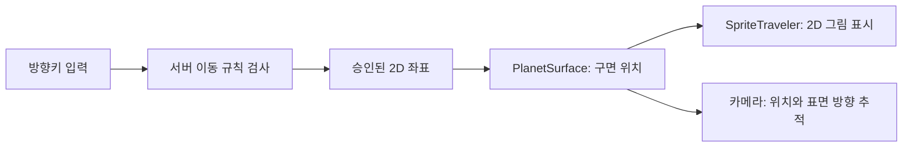

# 3D 행성 위에 2D 캐릭터를 올리는 방법

아래는 최초 맵 구현 설명이다. 현재는 화면 중심 기준 GPU 곡률과 고정 각도 카메라를 사용하고 포탈로 지역을 전환한다. 최신 구조는 REGIONS_CHANNELS_STORAGE.md에 있다.

원작 코드나 에셋을 추출한 것이 아니라, 원하는 화면을 만드는 구성 요소를 각각 구현했다.

1. **행성**: Unity의 실제 구 메시다. 반지름은 12이며 길·나무·바위를 표면에 배치한다.
2. **캐릭터**: 작은 투명 픽셀 이미지다. SpriteRenderer로 평면에 표시하며 항상 카메라 방향을 향한다. 이 방식을 빌보드라고 부른다.
3. **좌표**: 서버는 (x, z) 논리 좌표를 관리한다. 클라이언트의 PlanetSurface가 이를 구면의 3D 위치로 바꾼다.
4. **카메라**: 플레이어를 따라가면서 그 위치의 표면 법선에 맞춰 기울어진다. 캐릭터가 이동할 때 주변 지형이 둥글게 넘어가는 인상을 만든다.
5. **부드러운 움직임**: 서버 응답 위치로 한 번에 튀지 않도록 SpriteTraveler가 이전 표시 위치에서 새 위치까지 보간한다. 걷는 동안 방향별 2프레임 이미지를 교체한다.

논리 좌표 p의 원점으로부터 거리 d에 대해 각도 θ=d/R를 사용한다.
표면 법선 n은 `(x/d × sin θ, cos θ, z/d × sin θ)`이고,
3D 위치는 `구 중심 + R × n`이다. d=0이면 법선은 바로 위 방향이다.
나무·바위는 이 법선을 위쪽으로 삼고, 캐릭터 이미지는 카메라를 바라본다.

현재는 구의 한 지역을 사용하는 모델이다. 모든 방향의 거리가 보존되는 전역 구면 좌표계는 아니다.
서버의 이동·공격·충돌 거리는 논리 2D 좌표에서 판정한다.

이 조합만으로도 큰 공간감 차이가 난다. 원작과 같은 내부 구현이라고 확인된 것은 아니며,
현재의 나무·배경·캐릭터는 교체 가능한 임시 자산이다. 다음에는 좌표·서버 판정을 유지하면서
스프라이트 프레임, 카메라 거리·곡률, 지형 메시·텍스처를 각각 개선할 수 있다.
