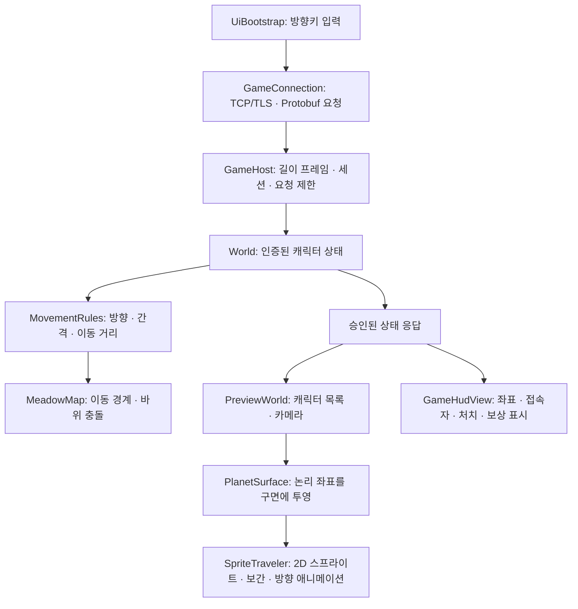

# 맵·이동 연결과 Git 사용

## 현재 실행

`Play.cmd` → 로컬 서버 시작 → 월드 선택 → 테스트 계정으로 초원 입장.
`SecondClient.cmd`는 첫 게임이 열린 동안 다른 계정으로 두 번째 창을 연다.
방향키로 이동, Z 또는 공격 버튼으로 슬라임 공격, I 가방, M 지도, ESC 시스템.
첫 실행 창을 닫으면 실행기가 서버를 정상 종료한다. 두 번째 창도 이후 연결이 끊긴다.
계정은 `data/local-player-1.json`, `data/local-player-2.json`에 로컬 테스트용으로 생성된다.
이 방식은 정식 로그인·캐릭터 선택 기능을 대신하는 개발용 입장 방식이다.

## 코드에서 따라갈 흐름



핵심은 이름만 클래스로 나누는 것이 아니라 변경 이유를 분리하는 것이다.
캐릭터 그림은 SpriteTraveler, 곡률은 PlanetSurface, 장애물은 MeadowMap,
이동 허용 규칙은 MovementRules에서 수정한다. 네트워크 스레드에서는 Unity API를 호출하지 않는다.
서버가 응답한 위치만 표시하므로 화면에서 좌표를 조작해도 서버 이동이 승인되지 않는다.
클라이언트 예측은 아직 없으며 서버 위치 사이를 부드럽게 보간한다.

## 구면과 좌표

반지름 12의 실제 3D 구를 사용한다. 서버는 반지름 7의 논리 2D 지역을 관리한다.
논리 좌표의 원점에서 떨어진 거리 d를 각도 d/12로 바꾸어 구면에 놓는다.
중심에서 바깥으로 걷는 거리는 구면 호 길이에 대응하지만, 모든 방향의 거리가
전역적으로 보존되는 것은 아니다. 전투·충돌 판정은 논리 2D 거리를 사용한다.
따라서 이것은 한 지역의 구면 표현이며, 지구처럼 경도·위도로 행성 전체를 도는 모델은 아니다.
원작의 내부 구현을 역공학으로 확인했다는 의미도 아니다.

지형은 표면 법선에 정렬하고, 캐릭터는 카메라를 향하는 평면 스프라이트로 그린다.
카메라는 플레이어를 따라가며 해당 표면 방향에 맞게 회전한다.
스프라이트는 교체 가능한 직접 작성한 픽셀 임시 이미지다. 나무·바위·슬라임도 임시 그래픽이다.

## Git으로 복구할 수 있는 범위

저장소 루트는 `outputs/PlanetServer`다. 최초 기준점은 `baseline-ui` 태그다.
작업 브랜치는 `feature/planet-movement`이며 GitHub 원격 저장소는 아직 연결하지 않았다.
전역 Git 사용자 설정은 바꾸지 않았고 이번 커밋 작성자는 `Codex <codex@local.invalid>`다.

프로젝트 폴더에서 실행:

```powershell
git status
git log --oneline --decorate
git diff
git diff baseline-ui -- src/Server/World.cs
git show baseline-ui:src/Server/World.cs
```

각각 변경 상태, 작업 이력, 미저장 변경, 기준점과의 차이, 당시 원본 내용을 보여준다.
소스 수정 후 의미 있는 단위로 `git add <파일>`과 `git commit -m "변경 이유"`를 사용한다.
앞으로 본인 커밋을 작성할 때는 이 저장소에 본인의 Git 이름·이메일을 설정한다.
이미 커밋한 변경을 취소할 때는 대상 커밋을 확인하고 `git revert <커밋ID>`로 취소 이력을 추가한다.
빌드 결과는 추적하지 않으므로 이전 소스로 돌아간 뒤에는 다시 빌드해야 실행 파일도 바뀐다.

Git에는 코드, Unity의 Assets와 .meta, ProjectSettings, 패키지 버전, 실행·검증 스크립트를 남긴다.
Library, 빌드 결과, 계정 데이터, 인증서, 로컬 비밀번호는 제외한다.
**Git은 게임 DB 백업이 아니다.** 저장 데이터의 백업·복구는 별도 운영 기능이다.
생성되는 Protocol.dll 및 외부 DLL은 Build.ps1이 복구하므로 새 체크아웃은 전체 빌드부터 한다.

## 검증과 현재 한계

- `scripts/Test.ps1`: 기존 인증·보상·저장·TCP/TLS와 이동 회귀 검사 34개 통과. 이번 실행은 PostgreSQL 환경변수가 없어 DB 통합 검사는 생략했다.
- `scripts/PlayMap.ps1 -Verify`: 실제 Unity 두 클라이언트, 서버 이동 반영, 구면 위치, 카메라 변화, 새 UI 창 열기, 기존 처치·보상 연결 검사.
- `scripts/VerifyUI.ps1`: 25화면·116개 배치 요소, 상호작용, 3해상도 검사. 서버와 분리된 UI 검수 모드다.

월드의 전역 잠금과 최대 16접속 제한은 기존 서버에 남아 있다. 부하 용량 검증을 수행한 것은 아니다.
이동 저장은 기존처럼 정상 접속 종료 시 수행하며 서버 강제 종료 직전 이동까지 보장하지 않는다.
체력·마나·아이템 창 등 아직 연결하지 않은 UI 값은 예시다. 실제 연결 값은 좌표·접속 수·처치·조각·골드다.
장애물은 두 바위의 원형 충돌이다. 맵 편집기, 임의 지형 충돌, 경로 탐색, 서버 틱 기반 이동,
네트워크 지연 보정, AOI, 정식 캐릭터 생성·분리 저장은 이후 작업이다.

## 채용공고에 맞춘 개발 기준

지금은 C#/.NET, TCP/TLS, Protobuf, Git, Unity와 서버 연동, 예외·정상 경로 검사에 해당한다.
PostgreSQL 저장 기반은 기존 구현을 유지했다. 앞으로 기능마다 서버 판정과 데이터 저장 범위를
명시하고, 테스트 결과와 제한을 기록한 뒤 커밋한다.
다음 우선순위는 이 맵의 이동감·카메라·캐릭터 애니메이션이며 캐릭터 생성은 그 뒤다.
