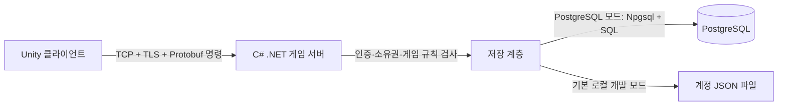
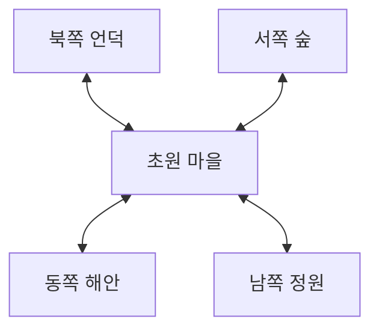

# 넓은 지역 화면, 포탈, 채널과 DB 연결

## 실제 저장 흐름

게임 서버가 이미 백엔드다. 별도의 HTTP REST 서버를 반드시 추가할 필요는 없지만 게임 클라이언트가
PostgreSQL에 직접 연결하는 구조는 사용하지 않는다. PostgreSQL 접속은 게임 서버의 Npgsql 드라이버가 맡는다.
PostgreSQL은 현재 프로젝트에서 클라이언트용 HTTP API 서버 역할을 하지 않는다.

Play.cmd의 기본 저장은 파일이다. PLANET_DB를 지정하고 scripts/PlayMap.ps1 -Postgres로 실행하면 PostgreSQL 저장을 사용한다.
PostgreSQL 인스턴스는 먼저 실행되어 있어야 한다. 파일 계정이 PostgreSQL로 자동 복사되지는 않는다.
서버 로그 storage 필드가 파일 모드를 잘못 표시하던 조건도 수정했다.

실제 구현은 비밀번호 PBKDF2 해시, TCP/TLS 인증서 고정, 세션 인증, 캐릭터 소유권 검사,
서버 이동·거리·포탈 판정, SQL 매개변수, revision 검사, 이름 고유 제약과 저장 트랜잭션이다.
이번 수정에서는 런처가 게임 서버를 시작한 뒤 PLANET_DB를 지워 Unity 자식 프로세스에 DB 접속 정보가 전달되지 않도록 했다.
현재 코드는 로컬 개발 환경이다. 로컬 계정 자동 생성, 테스트 비밀번호 파일, 자체 서명 인증서,
단일 프로세스 및 제한된 동접 구조를 갖고 있어 공개 서비스 보안 검토가 완료됐다는 뜻이 아니다.
운영에서는 DB 접근 주체·권한 제한과 서버-DB 구간 TLS도 별도로 설정해야 한다.
근거: [PostgreSQL 인증 문서](https://www.postgresql.org/docs/current/client-authentication.html),
[PostgreSQL TLS 문서](https://www.postgresql.org/docs/current/ssl-tcp.html).

## 화면 변경

첨부 이미지는 넓은 지역 일부가 화면을 채우며 지형이 완만하게 휘어 보인다. 이미지로 원작의 렌더링 코드를 확정할 수는 없다.
초기 구현은 구면 반지름을 12에서 60으로 늘렸다. 현재는 고정 각도 카메라와 화면 중심 기준 GPU 곡률 표현으로 변경했다.
서버와 지형 원본은 평면 좌표이며, 셰이더가 카메라 초점에서 먼 정점을 아래로 휘게 한다.
중앙은 약하게, 가장자리는 강하게 휜다. q=dx²+dz², 높이=-0.002q-0.00004q²이다.
2D 캐릭터 발 위치에도 같은 함수를 적용한다. 카메라 기울기는 이동해도 일정하다. 상하좌우에 같은 곡률을 사용하며 야외 지평선 뒤에 하늘과 구름을 표시한다.
이는 원작 내부 구현을 확인한 결과가 아니라 제공 이미지에 맞춘 자체 표현 방식이다.
이동 가능한 논리 영역은 x=-18~18, z=-22~22의 사각형이다. 배경은 그보다 넓게 그려 화면에 지면이 계속 보이게 한다.
논리 경계와 보여 주는 배경 크기는 서로 다르다. 배경에 땅이 보여도 서버가 허용하지 않은 곳으로는 이동할 수 없다.
나무가 있는 능선과 바위는 서버 충돌 데이터로 막는다. 포탈 이외의 가장자리는 통과할 수 없다.
캐릭터는 계속 2D 스프라이트이고, 카메라는 고정 각도로 위치만 따라간다.
플레이 화면의 큰 임시 안내와 가짜 버프 표시는 숨기고 이동 안내를 작은 줄로 줄였다.
아트는 자체 임시 도형이다. 원작 항구의 건물·텍스처·NPC 배치를 완성한 것은 아니다.

## 월드 → 채널 → 지역

- 월드: 현재 meadow 월드 하나.
- 채널: 1~30 선택. 캐릭터 선택 화면의 CH 버튼 또는 게임 중 ESC → 채널 이동.
- 지역: 초원 마을과 동쪽 해안·서쪽 숲·북쪽 언덕·남쪽 정원. 초원에 네 출구가 있고 주변 지역에는 되돌아오는 출구만 있다.

동서남북은 반드시 월드 좌표를 1 증가시키는 계산이 아니다. Regions의 포탈 데이터가
출발 지역의 portal ID를 목적지 region ID와 도착 좌표에 연결한다. 던전·실내처럼 비인접 공간도 같은 구조로 연결할 수 있다.

게임 서버의 현재 지역 상태는 (채널 ID, 지역 ID)별로 나눈다. 응답에는 같은 채널·같은 지역의 플레이어만 포함하며
몬스터 HP/재생성 상태도 이 단위로 분리한다. 캐릭터 진행 데이터는 채널을 바꿔도 유지한다.
채널은 현재 세션 선택이며 재접속 시 선택 화면에서 다시 정한다. 지역과 위치는 캐릭터 저장 데이터다.
채널 30개는 논리 분리이며 서버 프로세스 30개나 30배 처리 용량을 뜻하지 않는다. 접속 한도는 PLANET_MAX_CONNECTIONS로 설정하며 기본값은 128이다. 이는 프로세스 전체 연결 한도이며 채널 정원은 아니다. 전체 게임 잠금은 채널별 잠금으로 분리했다.

## 포탈 이동의 처리 순서

1. 클라이언트는 포탈 앞에서 F를 누르면 portal ID만 요청한다.
2. 서버는 인증·현재 지역·포탈 거리·열린 출구·재이동 간격을 확인한다.
3. 서버 데이터에서 목적지와 도착 좌표를 결정한다. 클라이언트가 임의 목적지를 지정할 수 없다.
4. 목적지 지역·좌표를 저장한다. 저장 실패면 원래 지역에 남긴다.
5. 서버의 활성 플레이어 상태를 옮기고, 새 지역 스냅샷을 돌려준다.
6. 클라이언트는 이전 지역의 지형·캐릭터 표시를 제거하고 새 지역을 구성한다. 카메라는 도착점에 즉시 맞춘다.

단일 서버에서 같은 채널의 포탈 전환을 직렬화한 구현이다. 별도 맵 서버 사이의 소유권 이관·전송 티켓·로딩 완료 ACK는 아직 구현하지 않았다.

## 미리 로딩하는가?

현재 구현은 지역 정의 데이터는 공유하지만, 지형 오브젝트는 현재 지역만 구성한다. 포탈을 통과할 때 목적지 지형을 즉시 생성한다.
공유 머티리얼은 재사용하지만 동서남북 지역을 모두 활성화하거나 인접 지역의 몬스터 상태를 클라이언트에 미리 보내지는 않는다.
원작이 무엇을 선로딩했는지는 제공 이미지로 알 수 없다.

향후에는 포탈 근처에서 목적지 그래픽 자산을 비동기로 미리 읽어 둘 수 있다. 그래픽 선로딩과
서버의 실제 입장은 다른 단계다. 파일이 미리 읽혀 있어도 서버가 전환을 승인하기 전에는 다음 지역에서 행동하지 못한다.

## 검증

서버 검사 74개 통과(PostgreSQL 포함): 포탈 원격 호출 거부, 닫힌 출구, 저장 실패 원위치 유지,
목적지 좌표, 이전 지역에서 제거, 재접속 지역 복원, 되돌아오기, 채널별 플레이어·몬스터 분리, 31번 채널 거부.
Unity 두 클라이언트에서도 실제 이동·전투·포탈·채널 30 전환을 검사한다.
VerifyLobby는 캐릭터 선택과 게임 내 채널 선택 UI 및 재시작 복원을 검사한다.
테스트는 부하 용량이나 전체 보안을 보장하지 않는다. 결과와 스크린샷은 region-captures에 저장한다.

## 포탈이 즉시 보이는 이유와 다음 작업

현재 BuildRegion은 서버 승인 후 목적지 전체 임시 지형을 동기 생성한다. 화면 밖 지형도 생성되며 GPU가 화면 밖 그리기를 생략한다.
작은 도형과 재사용 머티리얼만 사용하므로 큰 자산을 읽는 지연이 거의 없다. 비동기 스트리밍이나 상용 로딩 최적화를 완료한 상태는 아니다.
실제 자산 도입 시 준비/입장/실패 상태, 입력 차단, 비동기 읽기, 필요 시 로딩 표시를 추가해야 한다.

실행 흐름은 01 안내 → 02 로고 → 04 월드 선택 → 05 캐릭터 선택이다. 빈 월드 선택처럼 보이던 03은 실사용에서 제외하고 배치 검수용으로만 남겼다.

다음 개발 순서: (1) 실제 맵 데이터와 충돌/포탈 정의 분리 (2) 이동 지연 보간과 재접속/지역 로딩 실패 처리 (3) 부하 측정과 병목 개선 (4) DB 운영/배포/복구 검증.
로컬 TCP/TLS 64연결, 30채널, 10초 이동/조회 검사에서 5,952요청, 오류 0, p95 0.5101ms를 측정했다.
클라이언트와 서버가 같은 프로세스인 루프백 검사이며 로그인 단계, DB 부하, 인터넷 지연 및 장시간 안정성을 포함하지 않는다. 결과는 region-captures/load-64.json에 있다.
scripts/LoadProbe.ps1 -Clients 64 -Seconds 10으로 재실행한다. 상한 초과 연결 정책의 별도 검증도 필요하다.
p50/p95/p99 응답시간, 오류율, CPU, 메모리, DB 지연을 기록한다. 채널 내부 직렬 처리와 보상·포탈·퇴장 저장 경로를 분석한 뒤
지역별 처리와 저장 전략을 개선하고 같은 조건에서 다시 측정한다. 한도를 올리는 것만으로 확장성이 확보되지는 않는다.
채용공고의 기술을 사용한 것과 지원자의 이해/실무 능력, 상용 품질은 별개다. 실패 원인과 개선 결과를 직접 설명하는 기록이 필요하다.

## 현재 처리 경계와 MMORPG 확장 방향

현재는 연결별 비동기 통신 + 계정 잠금 256개 분산 + 채널별 잠금이다. 다른 채널의 게임 요청은 독립적으로 진행한다.
같은 채널의 요청은 저장을 기다리는 동안에도 직렬화한다. 계정 잠금 해시가 충돌하면 다른 계정도 잠시 기다릴 수 있다.
캐릭터 이름/로비 작업에는 공통 잠금이 남아 있고 로그인은 기본 채널에서 처리된다. 지역별 큐와 독립적인 시뮬레이션 루프까지 완성한 것은 아니다.
전환은 두 채널 잠금을 번호 순서로 얻어 교착을 피한다. 보상 저장을 멈춘 동안 다른 채널 이동, 보상 1회 반영, 반대 방향 전환을 회귀 검사했다.

월드 선택 → 여유 채널 자동 배정 → 캐릭터의 지역 입장이 목표 흐름이다. 현재는 월드 하나와 기본 CH1/수동 선택만 구현되어 있다.
아직 필요한 것: 채널 정원과 입장 예약, 혼잡도, 만원/점검 이동 거부, 전환 실패 복구, 지역별 시뮬레이션 루프,
주변 대상만 전송하는 관심 영역 관리, 지연·재접속 처리, 실제 맵/충돌 데이터, 운영 DB/백업/배포.
월드·채널·지역은 게임 규칙의 단위이고 프로세스·머신은 배치 단위다. 채널 한 개를 서버 한 대와 반드시 대응시키지 않는다.
이 책임을 코드에서 구분한 뒤 부하 측정에 따라 여러 프로세스로 나눈다. 현재 서버를 버리고 재작성할 필요는 없지만 위 사항은 구현/검증해야 한다.
