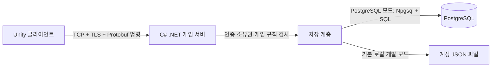
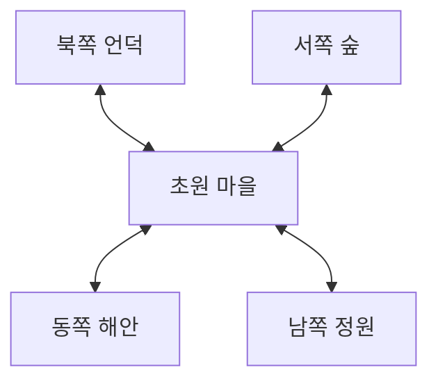

# 넓은 지역 화면, 포탈, 채널과 DB 연결

## 실제 저장 흐름

게임 서버가 이미 백엔드다. 별도의 HTTP REST 서버를 반드시 추가할 필요는 없지만 게임 클라이언트가
PostgreSQL에 직접 연결하는 구조는 사용하지 않는다. PostgreSQL 접속은 게임 서버의 Npgsql 드라이버가 맡는다.
PostgreSQL은 현재 프로젝트에서 클라이언트용 HTTP API 서버 역할을 하지 않는다.

Play.cmd의 기본 저장은 파일이다. PLANET_DB를 지정하고 scripts/PlayMap.ps1 -Postgres로 실행하면 PostgreSQL 저장을 사용한다.
PostgreSQL 인스턴스는 먼저 실행되어 있어야 한다. 파일 계정이 PostgreSQL로 자동 복사되지는 않는다.
서버 로그 storage 필드가 파일 모드를 잘못 표시하던 조건도 수정했다.

실제 구현은 비밀번호 PBKDF2 해시, TCP/TLS 인증서 고정, 세션 인증, 캐릭터 소유권 검사,
서버 이동·거리·포탈 판정, SQL 매개변수, revision 검사, 이름 고유 제약과 저장 트랜잭션이다.
이번 수정에서는 런처가 게임 서버를 시작한 뒤 PLANET_DB를 지워 Unity 자식 프로세스에 DB 접속 정보가 전달되지 않도록 했다.
현재 코드는 로컬 개발 환경이다. 로컬 계정 자동 생성, 테스트 비밀번호 파일, 자체 서명 인증서,
단일 프로세스 및 제한된 동접 구조를 갖고 있어 공개 서비스 보안 검토가 완료됐다는 뜻이 아니다.
운영에서는 DB 접근 주체·권한 제한과 서버-DB 구간 TLS도 별도로 설정해야 한다.
근거: [PostgreSQL 인증 문서](https://www.postgresql.org/docs/current/client-authentication.html),
[PostgreSQL TLS 문서](https://www.postgresql.org/docs/current/ssl-tcp.html).

## 화면 변경

첨부 이미지는 넓은 지역 일부가 화면을 채우며 지형이 완만하게 휘어 보인다. 이미지로 원작의 렌더링 코드를 확정할 수는 없다.
우리 구현은 곡률 반지름을 12에서 60으로 늘리고, 완전한 구체 대신 구면 위에 잘게 분할한 지형 패치를 그린다.
이동 가능한 논리 영역은 x=-18~18, z=-22~22의 사각형이다. 배경은 그보다 넓게 그려 화면에 지면이 계속 보이게 한다.
논리 경계와 보여 주는 배경 크기는 서로 다르다. 배경에 땅이 보여도 서버가 허용하지 않은 곳으로는 이동할 수 없다.
나무가 있는 능선과 바위는 서버 충돌 데이터로 막는다. 포탈 이외의 가장자리는 통과할 수 없다.
캐릭터는 계속 2D 스프라이트이고, 카메라는 해당 구면 방향을 따라간다.
플레이 화면의 큰 임시 안내와 가짜 버프 표시는 숨기고 이동 안내를 작은 줄로 줄였다.
아트는 자체 임시 도형이다. 원작 항구의 건물·텍스처·NPC 배치를 완성한 것은 아니다.

## 월드 → 채널 → 지역

- 월드: 현재 meadow 월드 하나.
- 채널: 1~30 선택. 캐릭터 선택 화면의 CH 버튼 또는 게임 중 ESC → 채널 이동.
- 지역: 초원 마을과 동쪽 해안·서쪽 숲·북쪽 언덕·남쪽 정원. 초원에 네 출구가 있고 주변 지역에는 되돌아오는 출구만 있다.

동서남북은 반드시 월드 좌표를 1 증가시키는 계산이 아니다. Regions의 포탈 데이터가
출발 지역의 portal ID를 목적지 region ID와 도착 좌표에 연결한다. 던전·실내처럼 비인접 공간도 같은 구조로 연결할 수 있다.

게임 서버의 현재 지역 상태는 (채널 ID, 지역 ID)별로 나눈다. 응답에는 같은 채널·같은 지역의 플레이어만 포함하며
몬스터 HP/재생성 상태도 이 단위로 분리한다. 캐릭터 진행 데이터는 채널을 바꿔도 유지한다.
채널은 현재 세션 선택이며 재접속 시 선택 화면에서 다시 정한다. 지역과 위치는 캐릭터 저장 데이터다.
채널 30개는 논리 분리이며 서버 프로세스 30개나 30배 처리 용량을 뜻하지 않는다. 기존 16접속 제한과 전역 잠금은 남아 있다.

## 포탈 이동의 처리 순서

1. 클라이언트는 포탈 앞에서 F를 누르면 portal ID만 요청한다.
2. 서버는 인증·현재 지역·포탈 거리·열린 출구·재이동 간격을 확인한다.
3. 서버 데이터에서 목적지와 도착 좌표를 결정한다. 클라이언트가 임의 목적지를 지정할 수 없다.
4. 목적지 지역·좌표를 저장한다. 저장 실패면 원래 지역에 남긴다.
5. 서버의 활성 플레이어 상태를 옮기고, 새 지역 스냅샷을 돌려준다.
6. 클라이언트는 이전 지역의 지형·캐릭터 표시를 제거하고 새 지역을 구성한다. 카메라는 도착점에 즉시 맞춘다.

단일 서버에서 포탈 전환을 직렬화한 구현이다. 별도 맵 서버 사이의 소유권 이관·전송 티켓·로딩 완료 ACK는 아직 구현하지 않았다.

## 미리 로딩하는가?

현재 구현은 지역 정의 데이터는 공유하지만, 지형 오브젝트는 현재 지역만 구성한다. 포탈을 통과할 때 목적지 지형을 즉시 생성한다.
공유 머티리얼은 재사용하지만 동서남북 지역을 모두 활성화하거나 인접 지역의 몬스터 상태를 클라이언트에 미리 보내지는 않는다.
원작이 무엇을 선로딩했는지는 제공 이미지로 알 수 없다.

향후에는 포탈 근처에서 목적지 그래픽 자산을 비동기로 미리 읽어 둘 수 있다. 그래픽 선로딩과
서버의 실제 입장은 다른 단계다. 파일이 미리 읽혀 있어도 서버가 전환을 승인하기 전에는 다음 지역에서 행동하지 못한다.

## 검증

서버 검사 71개 통과(PostgreSQL 포함): 포탈 원격 호출 거부, 닫힌 출구, 저장 실패 원위치 유지,
목적지 좌표, 이전 지역에서 제거, 재접속 지역 복원, 되돌아오기, 채널별 플레이어·몬스터 분리, 31번 채널 거부.
Unity 두 클라이언트에서도 실제 이동·전투·포탈·채널 30 전환을 검사한다.
VerifyLobby는 캐릭터 선택과 게임 내 채널 선택 UI 및 재시작 복원을 검사한다.
테스트는 부하 용량이나 전체 보안을 보장하지 않는다. 결과와 스크린샷은 region-captures에 저장한다.
